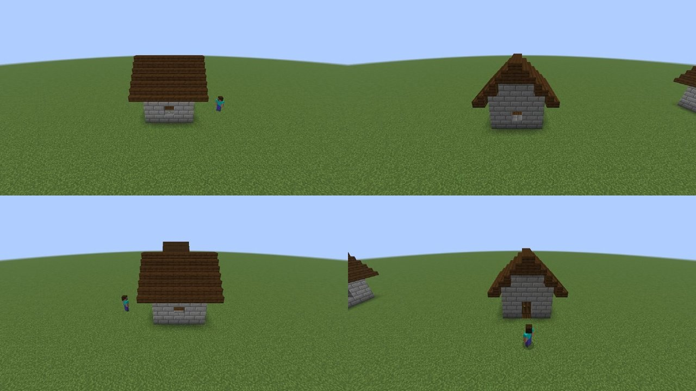
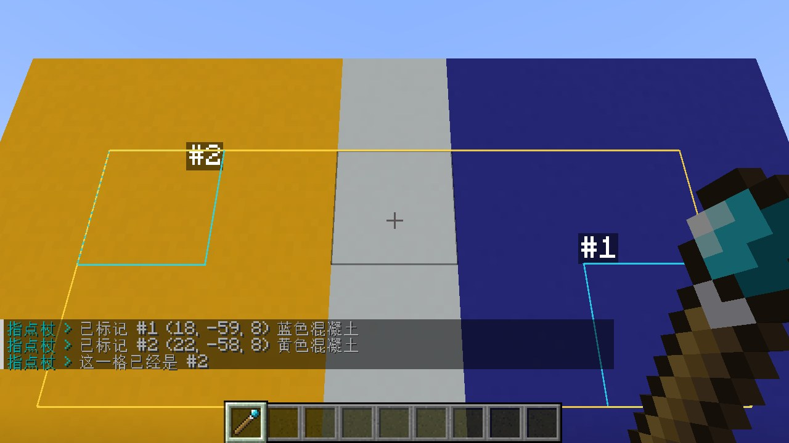

# Kizuna Agent

**An in-game AI assistant for Minecraft 26.2 (Fabric), built on the [pi coding agent](https://github.com/badlogic/pi-mono).** Type `/agent build a small stone watchtower in front of me` in chat and it works inside your open single-player world: it places blocks, runs commands, takes screenshots of the game to check its own work, inspects the JARs of your installed mods, and runs Python build scripts. It keeps a global memory and a library of reusable skills. Everything ships in one JAR; you bring your own model endpoint (any OpenAI-compatible or Anthropic API). The rest of this page is in Chinese.

---

Minecraft 26.2（Fabric）里的 AI 助手模组。在聊天栏里说一句话，它就在你正开着的单人世界里动手：盖建筑、执行指令、截游戏画面核对自己盖的东西、查各个模组 JAR 里的资源和类、跑 Python 建筑脚本。助手本体是 [pi coding agent](https://github.com/badlogic/pi-mono)，整个打在 JAR 里；模型用你自己的接口。



*助手盖完一间小屋后，用截图工具绕着拍了四面来检查（这四张是它自己拍的，玩家站在原地没动）。*



*拿指点杖右键标了两个方块：青框是标的点，黄框是两点围成的范围。接着说「把 1 到 2 这一块换成玻璃」就行。*

## 功能

- **盖东西、改地形**：直接改方块，大批量分 tick 落地不卡；每一步都能 `/agent undo` 撤回，连箱子里的东西一起还原。
- **执行指令**：以你的身份执行任何指令，拿回输出。
- **看得见**：截游戏画面本身（不是桌面）给模型看。可以截你现在的视角，也可以从指定的位置和角度截，或者绕着一个点拍四面加俯视；你本人不会被挪动。
- **指点杖**：一个物品，拿着右键方块就把坐标发给助手。标两个点，就能说「在 1 和 2 之间砌一堵墙」。
- **查模组**：列出装了哪些模组，读 JAR 里的语言文件、配置、数据包，搜关键词，看类的字段和方法签名。
- **Python**：助手能写脚本、跑脚本；你也可以自己用附带的 `kizuna_mc` 库从脚本里操作游戏。
- **记忆**：对它说「记住……」，它就记下，以后每段对话、每个世界都带着。
- **技能**：一件事做成了，让它「存成技能」，以后照着再做。技能就是 [Agent Skills](https://agentskills.io) 标准的 `SKILL.md` 加脚本。
- **换模型、调思考档位**：配置里写一份模型清单，游戏里一条指令切换。主模型额度用尽时自动换备用模型。

## 运行要求

- Minecraft 26.2，Fabric Loader 0.20.1 以上，Fabric API。
- Java 25（Minecraft 26.2 本来就要）。
- **Node.js 22.19 以上**：pi 是 Node 程序。装在 PATH 上或常见位置就能自动找到。
- Python 3（可选）：只在跑 Python 脚本时用。
- 一个模型接口和它的密钥：OpenAI 兼容接口、OpenAI Responses、Anthropic Messages、Google Generative AI 四种协议都行。要让它看截图，模型得能看图。

只在单人世界里工作。装在专用服务器上不会起作用。

## 安装

1. 把 `kizuna-agent-<版本>.jar` 放进实例的 `mods/`。
2. 进一次单人世界，生成 `config/kizuna-agent.toml`。
3. 在 `[model]` 里填接口地址、密钥、模型名，再进一次世界。
4. 聊天栏里 `/agent status` 看各项是不是都配好了，然后 `/agent 你好`。

## 配置

全部设置都在 `config/kizuna-agent.toml` 这一个文件里，生成出来的文件每一项都有注释。改完重新进一次世界生效。

OpenAI 兼容的接口（OpenAI、OpenRouter、各种中转、本机的 Ollama 和 LM Studio 都是这一种）：

```toml
[model]
api = "openai-completions"
base_url = "https://api.openai.com/v1"
api_key = "sk-..."
model = "gpt-4.1"
fallback_model = ""        # 主模型报 429 或额度用尽时自动换它；留空不换
thinking = "off"           # 思考档位：off、minimal、low、medium、high
vision = true              # 模型能不能看图；不能就写 false，截图只存成文件
```

Anthropic 的接口：

```toml
[model]
api = "anthropic-messages"
base_url = "https://api.anthropic.com"
api_key = "sk-ant-..."
model = "claude-sonnet-4-5"
thinking = "low"
```

本机模型（以 Ollama 为例；密钥随便填一个非空的）：

```toml
[model]
api = "openai-completions"
base_url = "http://127.0.0.1:11434/v1"
api_key = "ollama"
model = "qwen3:32b"
context_window = 32000
vision = false
```

其余几段：

| 键 | 意思 | 默认 |
|---|---|---|
| `[runtime] node` | Node.js 的位置；留空自动找 | 空 |
| `[runtime] python` | Python 的位置；留空自动找（Windows 上先试 `py -3`） | 空 |
| `[tools] local_code` | 让助手动这台电脑：读写文件、跑 Python、跑 PowerShell（Linux 和 macOS 上是 bash） | `true` |
| `[bridge] port` | 游戏内接口监听的本机端口；0 是每次随机挑 | `0` |
| `[bridge] blocks_per_tick_millis` | 批量放方块时每个 tick 最多占多少毫秒 | `10` |

### 模型清单和思考档位

想在游戏里换着用几个模型，就给每个模型写一段 `[[models]]`：

```toml
[model]
base_url = "https://openrouter.ai/api/v1"
api_key = "sk-or-..."
model = "fast"             # 清单里的别名，或者直接写模型名
fallback_model = "smart"
thinking = "low"           # 清单里没单独写 thinking 的模型用这一档

[[models]]
alias = "fast"
id = "google/gemini-2.5-flash"

[[models]]
alias = "smart"
id = "openai/gpt-5"
thinking = "medium"
thinking_levels = { low = "low", medium = "medium", high = "high" }

[[models]]
alias = "claude"
id = "claude-sonnet-4-5"
api = "anthropic-messages"
base_url = "https://api.anthropic.com"
api_key = "sk-ant-..."
```

| 键 | 意思 |
|---|---|
| `alias` | 游戏里叫它的名字；不写就用 `id` |
| `id` | 发给接口的模型名 |
| `thinking` | 这个模型的思考档位；不写就用 `[model]` 的 |
| `thinking_levels` | 这个模型认哪几档，每一档发给接口什么值（`reasoning_effort`） |
| `api`、`base_url`、`api_key`、`context_window`、`vision` | 这个模型自己的接口和能不能看图；不写就用 `[model]` 的 |

`thinking_levels` 有三种写法：

- **不写**：off、minimal、low、medium、high 五档，off 不发参数，其余照原名发。
- **写一张表**：只有表里的档位能选；值是这一档发给接口的 `reasoning_effort`，`off = ""` 表示关思考时不发参数。接口不认的档位别写。
- **写成 `{}`**：这个模型的思考强度由模型名决定，什么参数都不发，`/agent thinking` 对它不起作用。

各家接口认哪几档不一样，拿不准就试：让模型算一道费脑子的题，看应答用量里的推理 token 数随档位变不变。

## 游戏内指令

| 指令 | 做什么 |
|---|---|
| `/agent <要它做什么>` | 把话交给助手。它正在干活时，这句话插到它下一步之前 |
| `/agent stop` | 让它停下 |
| `/agent new` | 开一段新对话。记忆和技能还在 |
| `/agent undo` | 撤回它上一次放的方块，可以连着撤 |
| `/agent status` | 模型、思考档位、模型清单、Node、Python、接口各自的状态；哪项没配好这里会说 |
| `/agent model <名字>` | 换模型，下一句开始生效。清单里的别名能按 Tab 补全，也可以直接写一个模型名 |
| `/agent thinking <档>` | 调现在这个模型的思考档位，下一句开始生效，并写回配置文件 |
| `/agent memory` | 列出它记着的事 |
| `/agent memory forget <第几条>` | 删掉一条记忆 |
| `/agent skills` | 列出它的技能 |

- 一句话恰好以这些词开头也没关系：`/agent new house` 是让它盖新房子，不是开新对话。
- 助手说的话、每一步在做什么（灰色斜体）、出错（红色）都显示在聊天栏。
- 退出世界时助手进程结束；再进世界接着上次的对话。

## 指点杖

创造模式物品栏里有一个「Kizuna Agent」栏，里面是指点杖；生存模式用一根木棍加一根羽毛合成。

| 操作 | 效果 |
|---|---|
| 右键方块 | 标下这个方块，聊天栏回「已标记 #1 (x, y, z) 石砖」。拿着它右键箱子、门也只是标记，不会打开 |
| 右键够不着的地方 | 标准星指着的远处方块（128 格以内）；指着天空就标你脚下 |
| 蹲下右键 | 清空全部标记 |

标了的方块在世界里描出青色的框，上面浮着编号；正好两个点时再用黄线画出它们围成的长方体。下一句 `/agent` 会自动带上这些点，所以直接说「在 1 和 2 之间砌一堵墙」「把 #3 换成玻璃」就行。最多同时标 16 个，退出世界清空。

## 记忆和技能

- **记忆**：对助手说「记住，我的屋顶一律用深色橡木」，它就存一条。之后每句话它都带着这些记忆，换对话、换世界都在。它自己摸索出的偏好和坑也会记。最多 50 条、每条 300 字，快满时它会整理。文件是 `config/kizuna-agent/pi-home/MEMORY.md`，一条一行，可以手改。
- **技能**：一件事做成以后说「存成技能」，它把步骤和脚本写成一个技能目录：`config/kizuna-agent/pi-home/skills/<名字>/SKILL.md`，脚本在旁边。之后遇到对得上的事，它先读技能再照着做。格式是 [Agent Skills](https://agentskills.io) 标准，别处拿来的技能目录放进去也认。

这两样只写在本模组自己的数据目录里，关掉 `local_code` 也照常能用。

## 助手能用的工具

| 工具 | 做什么 |
|---|---|
| `mc_command` | 以玩家身份执行指令，拿回输出 |
| `mc_player` | 玩家位置、朝向、准星指着的方块 |
| `mc_get_blocks` | 读一块区域（最多 64×64×64） |
| `mc_set_blocks`、`mc_fill`、`mc_clone` | 批量放方块、填充、复制；分 tick 落地 |
| `mc_undo` | 撤回最近一次放的方块 |
| `mc_screenshot` | 截游戏画面：玩家视角、指定机位、绕一个点拍几面，或者连 HUD 和界面一起 |
| `mc_marks` | 读玩家用指点杖标的点 |
| `mc_mods` | 已加载的模组和 JAR 路径 |
| `mc_jar_list`、`mc_jar_read`、`mc_jar_search` | 列 JAR 里的文件、读文本资源、在各模组的文本里找词 |
| `mc_jar_classes`、`mc_jar_class` | 列类、看类的字段和方法签名（不是源码） |
| `memory_save`、`memory_forget` | 记一条、删一条全局记忆 |
| `skill_save`、`skill_read`、`skill_delete` | 存、读、删技能 |
| `run_python` | 跑一段 Python，或者跑一个已有的脚本文件 |
| 读写文件、PowerShell（Linux 和 macOS 上是 bash） | pi 自带的工具，工作目录在 `config/kizuna-agent/workspace/` |

最后两行在 `[tools] local_code = false` 时没有。

## 自己写 Python

第一次用助手时，库和示例解到 `config/kizuna-agent/python/`。世界开着的时候，在那个目录下直接跑：

```
python examples/tower.py 4 12
```

```python
from kizuna_mc import mc

here = mc.player().block                       # 玩家脚下
mc.fill(here + (2, 0, -3), here + (8, 0, 3), "minecraft:stone_bricks")
mc.set_blocks(here + (5, 1, 0), [((0, y, 0), "minecraft:oak_log[axis=y]") for y in range(6)])
region = mc.get_blocks(here + (2, 0, -3), here + (8, 6, 3))
print(region.counts())
for shot in mc.screenshot(orbit={"target": here + (5, 3, 0), "distance": 14, "top": True}):
    print(shot.label, shot.file)               # 每张图存成文件
print(mc.marks())                              # 指点杖标的点
mc.jar_search("diamond", glob="**/lang/en_us.json")
mc.undo()
```

库只用标准库，全部方法的说明在 `kizuna_mc.py` 开头。助手跑脚本时连接信息已经在环境变量里；你自己跑时它读 `config/kizuna-agent/bridge.json`。

## 安全

这个模组让一个语言模型在你的世界里、（默认）也在你的电脑上动手。装之前请知道这几件事：

- **动电脑的开关**：默认开着，助手能读写这台电脑上的文件、跑 Python 和 shell 命令，权限和你启动游戏的账户一样。不想要就在配置里写 `[tools] local_code = false`，它就只剩游戏内的工具、截图、记忆和技能。
- **只听本机**：游戏内接口只监听 `127.0.0.1`。每次开世界随机生成一个令牌，写在 `config/kizuna-agent/bridge.json`，关世界时删掉。没有令牌的请求、带 `Origin` 头的请求（网页发来的）一律拒绝。
- **只在单人世界**：按世界主人的权限执行，不受「允许作弊」开关限制。对局域网开放后，别的玩家用不了助手。
- **密钥**：只在 `config/kizuna-agent.toml` 里；交给 pi 进程时走环境变量，不写进日志和别的文件。
- **模型看到什么**：你说的话、工具的结果（方块、指令输出、JAR 里的文字、截图）会发给你配置的那个模型接口。
- **技能里可以有脚本**：别处拿来的技能，放进去之前先看一眼内容。
- **改坏了**：放方块的工具都能撤回；指令改的东西撤不回。重要的存档先备份。

## 数据目录

都在实例的 `config/kizuna-agent/` 下面：

| 路径 | 是什么 |
|---|---|
| `pi-<版本>/` | 解出来的 pi 运行文件 |
| `pi-home/` | pi 的设置、系统提示词，和 `MEMORY.md`、`skills/` |
| `python/` | `kizuna_mc.py` 和示例 |
| `workspace/` | 助手的工作目录：`scripts/` 是它跑过的脚本，`screenshots/` 是它截的图 |
| `sessions/` | 对话记录 |
| `bridge.json` | 世界开着时的接口地址和令牌 |

## 游戏内接口

世界开着时，全部功能都能经 `POST http://127.0.0.1:<端口>/v1/<名字>` 调用，请求头带 `Authorization: Bearer <令牌>`，请求体和应答都是 JSON。Python 库就是包了这一层。

| 接口 | 请求 | 应答 |
|---|---|---|
| `command` | `command` | `success`、`result`、`output`（每行一项） |
| `player` | 无 | `block`、`position`、`yaw`、`pitch`、`facing`、`dimension`、`looking_at`、`can_edit` |
| `blocks/get` | `from`、`to`，可选 `nbt`、`dimension` | `origin`、`size`、`palette`、`blocks`（下标，顺序 y→z→x） |
| `blocks/set` | `origin`、`palette`、`blocks`（每项 `[dx, dy, dz, 下标]`），可选 `mode`、`dimension` | `changed`、`skipped`、`undoable`、`ticks` |
| `blocks/fill` | `from`、`to`、`block`，可选 `replace`、`hollow`、`mode`、`dimension` | 同上 |
| `blocks/clone` | `from`、`to`、`destination`，可选 `mode`、`dimension` | 同上 |
| `undo` | 无 | `restored`、`remaining` |
| `screenshot` | 可选 `camera`（`position`，再加 `look_at` 或 `yaw`、`pitch`，可选 `fov`）、`orbit`（`target`、`distance`，可选 `elevation`、`sides`、`top`、`fov`）、`hud`、`width` | `shots`（`label`、`file`、`width`、`height`、`mime`、`data` 是 base64、`notes`） |
| `marks` | 无 | `marks`（`number`、`block`、`dimension`、`state`、`face`、`kind`） |
| `memory/list`、`memory/save`、`memory/forget` | 无；`text`；`number` | `entries`；`number`、`count`；`removed`、`count` |
| `skills/list`、`skills/read`、`skills/save`、`skills/delete` | 无；`name`，可选 `file`；`name`、`description`、`body`，可选 `files`；`name` | `skills`；`text`、`files`；`directory`、`updated`；`count` |
| `mods` | 无 | `mods`（`id`、`version`、`name`、`jar`） |
| `jar/list` | `mod`，可选 `prefix`、`glob`、`limit` | `entries`（`path`、`size`）、`total`、`truncated` |
| `jar/read` | `mod`、`path`，可选 `offset`、`max_bytes` | `text`、`size`、`truncated` |
| `jar/search` | `text`，可选 `mod`、`glob`、`limit`、`case_sensitive` | `matches`（`mod`、`path`、`line`、`text`） |
| `jar/classes` | `mod`，可选 `prefix`、`limit` | `classes` |
| `jar/class` | `mod`、`class`，可选 `private` | `kind`、`extends`、`implements`、`fields`、`methods` |

- 方块写法和 `/setblock` 一样，带内容的方块可以跟 NBT。
- `mode`：`shapes`（默认，相邻方块形状联动）、`physics`（再加方块更新）、`strict`（完全照给的状态放）。
- 上限：读和复制一次 64×64×64，放和填一次一百万个。被替换的方块不掉落、里面的东西不洒出来。
- 截图的朝向：yaw 0 朝南（+z）、90 朝西、180 朝北、-90 朝东；pitch 正数是低头。机位超出渲染距离时不截，报错说明。
- 出错时应答是 `{"ok": false, "error": {"code": …, "message": …}}`，`message` 是一句说得清错在哪儿的话。

## 从源码构建

要 JDK 25 和 Git。第三方库的版本表放在 [Kizuna-Meridian-Mod-Framework](https://github.com/Kizunad/Kizuna-Meridian-Mod-Framework) 仓里，所以要把两个仓并排放：

```
git clone https://github.com/Kizunad/Kizuna-Meridian-Mod-Framework
git clone https://github.com/Kizunad/Kizuna-Agent
cd Kizuna-Agent
./gradlew build            # 产物在 build/libs/
./gradlew runGametest      # 服务端 GameTest
./gradlew runClientGametest   # 真客户端验收：真的 pi 和游戏内接口，模型是一个照剧本答话的假接口
```

代码分几块：

- `src/main/java/dev/kizuna/agent/bridge/`：游戏内接口。
- `src/main/java/dev/kizuna/agent/pi/`：找 Node 和 Python、解出 pi、拉起 pi 进程、把它的事件变成聊天栏里的一行行话。
- `src/main/java/dev/kizuna/agent/client/`：`/agent` 指令、聊天栏显示、截图、标记的描线。
- `src/main/java/dev/kizuna/agent/notes/`、`marks/`：记忆、技能库、指点杖。
- `src/main/resources/kizuna-agent/`：pi 扩展（把接口做成 pi 的工具）、Python 库和示例、系统提示词、默认配置。
- `runtime/pi-<版本>.zip`：pi 的运行文件，由 `scripts/pack_pi.py` 从本机装好的 pi 打出来；升级 pi 的步骤写在那个脚本开头。

## 许可

本仓的代码和资源是 MIT 许可，见 [LICENSE](LICENSE)。

JAR 里带着这些第三方软件，许可证全文在 JAR 的 `META-INF/licenses/`（仓里是 [`runtime/licenses/`](runtime/licenses/)）：

- [pi coding agent](https://github.com/badlogic/pi-mono)（`@earendil-works/pi-coding-agent` 及其 pi-ai、pi-agent-core、pi-tui）：MIT。
- pi 运行时用到的 typebox、undici、jiti、photon-node 等：各自的许可证见上面那个目录里的 `PI-RUNTIME-NOTICE.txt` 和同名文件。
- [tomlj](https://github.com/tomlj/tomlj)（Apache-2.0）和它用的 ANTLR 运行库（BSD-3-Clause）。
